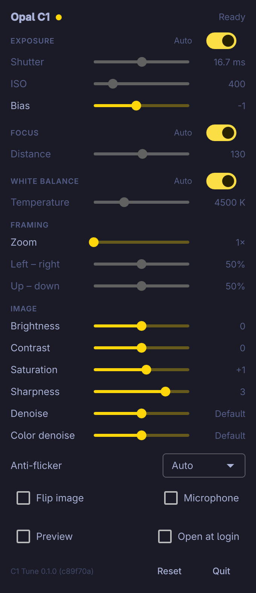

# C1 Tune for Omarchy

A small, fast tool for the **Opal C1** webcam on [Omarchy](https://omarchy.org) (Arch +
Hyprland): real hardware controls, applied by the camera itself, and nothing else. A port of
[C1 Tune for macOS](https://github.com/ryankirkman/c1-tune).

<p align="center">
  
</p>

- **Fast.** A 1080p30 webcam about 3 seconds after the camera's bootloader appears on USB;
  reattaches to a running camera in under a tenth of a second. Idles at 0% CPU
  (see [Measured](#measured)).
- **Real controls.** Exposure, focus, white balance, color, and zoom up to 2× without
  upscaling. The camera shows up as a plain UVC webcam to every app.
- **Lightweight.** The app that stays running is one ~380 KB binary linking only libc and
  libstdc++. No virtual camera, no PipeWire nodes, no services, no polling.
- **Safe.** Nothing is ever written to the camera's flash; unplugging it restores factory
  behaviour, and so does quitting C1 Tune (about 10 seconds).

Not affiliated with or endorsed by Opal Camera.

## Install

```bash
git clone https://github.com/ryankirkman/c1-tune-omarchy.git && cd c1-tune-omarchy
make install     # builds the Arch package and installs it with pacman (asks for sudo)
```

The package installs `c1-tune`, its control panel, a launcher entry, and the udev rule that
lets you (not just root) talk to the camera. Then open **C1 Tune** from the launcher
(`Super + Space`) and tick **Open at login**. Settings are saved and re-applied whenever the
camera connects or an app starts using it.

The first start downloads the camera's firmware from Luxonis (8 MB, once, SHA-256 pinned).
For Opal's own picture, also run `c1-tune --fetch-tuning` once (see [Tuning](#tuning)).

Without the package (nothing but the udev rule needs sudo):

```bash
make udev            # once: lets you talk to the camera
make install-user    # app, panel, launcher entry, bar button and audio rule under ~/.local and ~/.config
```

### On the bar, or on a key

A bar button for the Omarchy shell ships with the package (`make install-user` copies it
for you):

```bash
mkdir -p ~/.config/omarchy/plugins
cp -r /usr/share/c1-tune/bar-widget ~/.config/omarchy/plugins/com.ryankirkman.c1-tune
omarchy plugin enable com.ryankirkman.c1-tune     # run it again if it says the plugin is unknown
```

Or bind a key in `~/.config/hypr/bindings.lua` (pick one that's free on your setup):

```lua
o.bind("SUPER + ALT + C", "C1 Tune", "c1-tune --panel")
```

Either one opens the panel, and closes it if it's already open.

## Controls

| | |
|---|---|
| Exposure | Auto with bias (−9…+9), or manual shutter (0.1–33 ms) and ISO (100–1600) |
| Focus | Continuous autofocus, or manual lens position |
| White balance | Auto, or manual 1000–12000 (the firmware's scale, not true Kelvin) |
| Image | Brightness, contrast, saturation, sharpness, denoise, color denoise |
| Anti-flicker | Auto / 50 Hz / 60 Hz / off |
| Zoom | 1×–2× in 20 steps, never upscaled |
| Framing | Moves the zoomed picture left–right and up–down (snaps to center) |
| Flip image | Turns off the default 180° rotation, for a camera mounted upside down |
| Microphone | The camera's built-in mic, off by default |
| Preview | Optional live view in the panel (needs `qt6-multimedia`) |

Most changes apply instantly. Zoom, framing, flip, the microphone, the tuning file, and
returning sharpness/denoise to default restart the camera (about 5 seconds, once per burst
of changes).

In the panel: `Esc` or `Q` closes it, `P` toggles the preview, `R` retries after a failure,
`Tab` and the arrow keys move between and adjust the sliders.

**Scripting:** every setting can be set from the command line, with the same keys as the
macOS app:

```bash
c1-tune --set zoom=125 frameY=60 saturation=1
c1-tune --status          # state and settings as JSON
```

`autoExposure exposureUs iso exposureCompensation autoFocus lensPosition autoWhiteBalance
whiteBalanceK brightness contrast saturation sharpness noiseReduction colorNoiseReduction
antiFlicker zoom frameX frameY flipped microphone tuningFile`

`default` clears sharpness or a denoise value back to the tuning's own. `c1-tune --help`
lists the other commands (`--reset`, `--restart`, `--retry`, `--quit`).

## Tuning

On macOS, C1 Tune uses the image tuning that ships inside Opal Composer. Opal Composer
doesn't exist on Linux and its files can't be redistributed, so out of the box the camera
runs on **the firmware's own tuning**. To use Opal's:

```bash
c1-tune --fetch-tuning
```

This downloads Opal Composer 1.0.1 from Opal's own server (100 MB, once, SHA-256 pinned),
copies the two tuning files out of the disk image into `~/.config/c1-tune/`, and restarts the
camera. Nothing from the download is installed or run. It needs `python`; the unpacking is a
short script (`scripts/fetch-opal-tuning`) using only the standard library.

`Opal_v0.12.bin` (IMX378) or `Opal582_v2.bin` (IMX582) in `~/.config/c1-tune/` is picked up
by name on every camera start; a copy from a Mac works the same. To use a tuning file kept
somewhere else:

```bash
c1-tune --set tuningFile=/path/to/Opal_v0.12.bin     # tuningFile=default to stop
```

The defaults (bias −1, saturation +1, sharpness 3) were chosen on top of Opal's tuning.
With the firmware's own, colors are a little warmer and more saturated and the picture
sharper; adjust to taste.

## Microphone

**Off by default.** The camera still appears as an "Opal C1" input, but with no audio
pipeline behind it an app that records from it just waits. **On**, it's a normal USB mic set
up the way Opal Composer does it: the two front mics at a fixed 30 dB gain.

The firmware's audio side is fragile in a way Linux exposes and macOS doesn't: **a
microphone stop followed straight away by a start hangs the camera for good** (no video, no
USB) until it is unplugged. Two things in a normal PipeWire session do exactly that, and
both are handled:

- **PipeWire probes a new sound card** by opening and closing it about 60 times in a tenth
  of a second. A microphone pipeline starting inside that burst hung the camera 4 times out
  of 4. C1 Tune now waits until the sound card has been left alone for 400 ms before it
  starts a pipeline with the microphone (about half a second, only with Microphone on):
  0 hangs in 11 boots.
- **PipeWire releases an idle device after 5 seconds.** Recording again at that moment
  (the pause between two dictated sentences) hung it. The package installs a WirePlumber
  rule (`opal-c1-no-suspend.conf`) that keeps this one microphone open, so the camera sees
  a single start and no stops. With it: 33 recordings with pauses from 0.1 to 20 s,
  including 18 across the 4.7–5.4 s range that hung it, and four WirePlumber restarts with
  the microphone in use, without a hang.

What is **not** protected: a program that bypasses PipeWire and opens and closes the ALSA
device itself in rapid succession (fifteen record start/kill cycles a quarter of a second
apart hung it). Nothing ordinary does that. If the camera does hang, C1 Tune says "The
camera isn't responding. Unplug it and plug it back in."

## Measured

On an IMX378 Opal C1 behind a USB 3 hub, Omarchy on x86-64, three runs each:

| | |
|---|---|
| Plugged in (kernel first sees it) → ready, app already running | 3.06 s |
| Camera's bootloader appears → ready | 2.95 s |
| …→ first video frame in an app | 3.1 s |
| The same with Microphone on (waits out PipeWire's probe) | 3.45 s |
| App launched with the camera in factory mode → ready | 3.6–3.7 s |
| Zoom/flip/microphone restart, after the 1 s it waits for more changes | 4.0 s |
| App relaunched while the camera is running → ready | 0.03–0.09 s |
| Quit, then reopened 0.3–12 s later → ready | 2.9–6.6 s |
| Panel window on screen after `c1-tune --panel` | 0.23 s |
| CPU, camera ready and idle | 3.8 ms per 30 s (0.013% of a core) |
| CPU, while another app streams | 0.02% of a core |
| Memory, the app | 7 MB resident, 3 MB of its own |

Of the 2.95 s, about 1.5 s is the bootloader dropping to the boot ROM, 0.9 s the 25 MB
firmware upload at USB 2 speed (the boot ROM doesn't do USB 3), and 0.5 s the firmware
starting. The app's own share is under a tenth of a second.

## How it works

The [macOS README](https://github.com/ryankirkman/c1-tune#how-it-works) explains the camera
side: reboot to the bootloader, drop to the USB boot ROM, upload DepthAI firmware to RAM,
start a pipeline over RPC, and send every setting as a `CameraControl` message. This port
sends the camera the same bytes in the same order; `make test` checks the encoders against
the same reference fixtures, byte for byte.

<details>
<summary>What testing on Linux added (and the code relies on)</summary>

- **Hold the bootloader link open until the boot ROM appears.** Closing it right after the
  `USB_ROM_BOOT` write is acknowledged (which Linux does in under a millisecond) makes the
  bootloader ignore the command and restart itself. The link is now closed once the camera
  has left the bus.
- **The factory app is recognized without asking it.** It reports USB device version 2.00;
  the DepthAI firmware 3.20. Opal's app answers an XLink ping only by timing out after 2 s,
  so when the version says it's Opal's, the ping is skipped. Everything from the reboot
  request on is unchanged.
- **The firmware says when video starts.** It prints `UvcDevice_Start` on its log stream,
  and logs "Skipping command … for Non active camera" for controls sent while idle, which
  confirms why settings are re-sent at that moment. A session that reattached to a running
  camera gets no log stream, so an app opening `/dev/video*` (inotify) triggers the re-send
  as well.
- **The camera's watchdog only resets it if no app has streamed since boot.** After any
  video stream it keeps running unattended when its host goes away. So quitting C1 Tune
  sends the reboot request itself, and the camera's bootloader, with nobody talking to it,
  starts the factory app. If C1 Tune is killed instead, the camera may keep running its last
  pipeline until it is unplugged or C1 Tune starts again (and reattaches).
- **The microphone must never be stopped and started in quick succession**; see
  [Microphone](#microphone).
- **A bootloader that has waited about four seconds ignores the boot-ROM command** and
  starts the factory app. Reopening C1 Tune a few seconds after quitting it lands there, so
  the boot then goes round once more instead of failing.
- **Every app gets 1920×1080 NV12 at 30 fps**, and nothing else is advertised.
</details>

What's different is the Linux side:

| macOS | Here |
|---|---|
| IOKit | usbfs (`/dev/bus/usb`) ioctls, no libusb |
| Polling for the camera every 1.5 s | udev's netlink broadcasts: the app sleeps until a device arrives or leaves |
| CoreMediaIO "is running somewhere" | inotify on the camera's `/dev/video*` node: an app opening it triggers the re-send |
| Menu bar popover (AppKit) | A separate Qt Quick panel that follows the Omarchy theme, talking to the app over a Unix socket |
| Opal Composer's firmware and tuning | Luxonis's firmware download; optional tuning file |
| Login item | An XDG autostart entry (`~/.config/autostart/c1-tune.desktop`) |
| `disable-opal.sh` | Not needed: nothing else on Linux claims the camera |

The app (`c1-tune`) and the panel (`c1-tune-panel`) are separate programs on purpose. The
app is what stays running, so it links no toolkit and does nothing until the kernel wakes
it; the only thing it does on a clock is feed the camera's watchdog (one 4-byte USB write
every half second, which the camera requires). The panel exists only while it's open.

| File | |
|---|---|
| `src/depthai.*` | libnop/msgpack encoders, boot image + descriptor patch, pipeline schema, RPC |
| `src/settings.*` | Saved settings → camera commands, zoom/framing |
| `src/usb.*` | usbfs access to each boot stage, udev event monitor |
| `src/xlink.*` | XLink link protocol (84-byte headers, streams, watchdog keepalive) |
| `src/session.*` | Boot/attach state machine and control delivery |
| `src/firmware.*` | Firmware download and pinning, tuning file lookup |
| `src/main.cpp` | The app's event loop, its socket, and the command line |
| `panel/` | The control panel |
| `bar-widget/` | A button for the Omarchy bar |
| `scripts/fetch-opal-tuning` | Gets Opal's tuning files from Opal's installer |
| `pkgbuild/` | Arch package, udev rule, WirePlumber rule, launcher entry, icon |

Files: settings in `~/.config/c1-tune/settings.json`, firmware in `~/.local/share/c1-tune/`.

## Make targets

| | |
|---|---|
| `make` | Build `build/c1-tune` and `build/c1-tune-panel` |
| `make test` | Protocol tests (no camera needed; `C1TUNE_TEST_DOWNLOAD=1` also checks the firmware download) |
| `make install` | Build the Arch package and install it |
| `make udev` | Install only the udev rule |
| `make install-user` / `uninstall-user` | Install under `~/.local` and `~/.config` without sudo, or remove that |

Uninstall with `sudo pacman -R c1-tune`; settings and the cached firmware are the two
directories above.

## Limitations

- **Tested on one camera**: an IMX378 Opal C1 on one Omarchy machine. The IMX582 revision's
  tuning is picked automatically but untested.
- **English only.** The panel's strings are marked for translation but no catalogs ship yet.
- **No live readout of auto values**, and **zoom restarts the camera**, as on macOS.
- **The microphone can't be hidden**, and its gain is fixed, as on macOS. Its firmware can be
  hung by rapid direct ALSA open/close cycles (see [Microphone](#microphone)).
- If the camera hangs off a monitor's USB hub, it disappears when the monitor sleeps. C1 Tune
  picks it up again when it returns.
